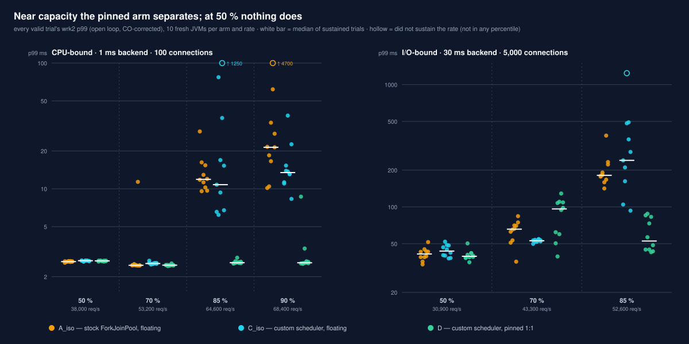
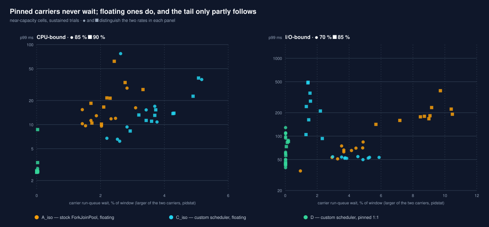
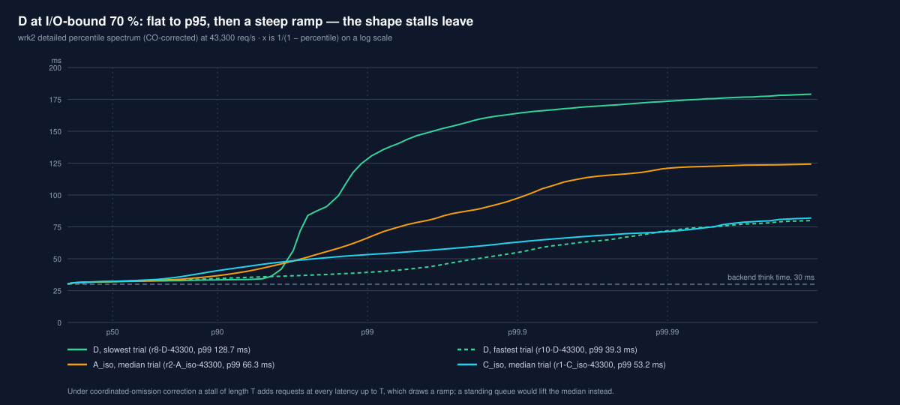
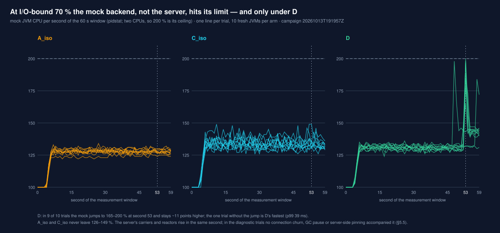

# Pinned carriers hold the open-loop tail near capacity, and only there

*A custom Loom `VirtualThreadScheduler` against the stock `ForkJoinPool` scheduler, on a transport
whose readiness detection and continuation execution run on different threads.*

> **What this is.** A within-tier comparison of three virtual-thread scheduler arms on one kernel
> build, one JDK build and one host. It answers one question — *does a scheduler that keeps one
> queue per carrier, with each carrier pinned to its own CPU, bound the open-loop tail?* — for two
> backend latencies. It is the first result of the research track `research/loom-carrier-scheduler`
> (kernel `docs/research/loom-carrier-scheduler/research.md`) and replaces nothing: the
> 2026-09-27 pilot (`results/history/loom-carrier-scheduler-pilot-2026-09/`) is archived as
> non-evidence and no figure here is read against it.
>
> **Axis labels.** Tier **Community** (FFM POSIX socket transport, platform `Selector` reactors).
> Protocol **H1 cleartext**, as the load vehicle only: `wrk2` paces HTTP/1.1, and scheduling sits
> below the protocol, which is not a factor here. Family **Runtime**. Comparison axis: **scheduler
> arm, within one kernel commit**. Not a cross-runtime comparison and not a statement about the
> Enterprise `io_uring` transport.
>
> **`claim_scope: comparison_eligible`** is carried by exactly two campaigns, both under
> `results/raw/loom-carrier-scheduler/`: `20261009T040618Z-jdk-kbc26f9a0e8fc` (CPU-bound, 129 of 129
> trials valid) and `20261013T191957Z-jdk-kbc26f9a0e8fc` (I/O-bound, 99 of 99 valid). Every trial in
> both ran on a shielded host from committed harness files. §7 is exploratory and labelled at the
> point of use; no comparative claim rests on it.
>
> **`reproducibility_status: partial`.** Every figure was re-derived from the campaigns'
> `trial.json` and `load.txt` by a pass separate from the harness's own summary, and the two agree.
> Each regime rests on one campaign; neither has been repeated, and no second person has
> re-derived anything.

---

## TL;DR

1. **Near capacity, pinning separates completely.** At 85 % of the stock scheduler's saturation rate
   the pinned custom scheduler (`D`) has a lower p99 than both floating arms in every one of its
   10 trials, in both regimes: **2.58 ms** against 11.89 (`A_iso`) and 10.79 ms (`C_iso`) with a
   1 ms backend, **52.6 ms** against 181 and 240 ms with a 30 ms backend. Exact Mann–Whitney
   p ≤ 2.2 × 10⁻⁵ for each pair, which survives a Bonferroni correction over all 42 tests in this
   report. At 90 % (CPU-bound only) nearly the same: 2.58 ms against 21.4 and 13.5 ms, with one
   `D` trial (8.66 ms) inside the floating arms' range.
2. **Below capacity, it does not.** At 50 % no arm separates from another in either regime: p99
   medians within 0.05 ms of each other with a 1 ms backend, within ~4 ms with a 30 ms backend.
3. **At 70 % with the 30 ms backend, the pinned arm is the worst; the stall is observed on the backend's side, and only under `D`.**
   Median p99 96 ms against 66 (`A_iso`) and 53 ms (`C_iso`), bimodal across JVMs — four trials
   at 39–62 ms, six at 94–129 ms — with both carriers at ~58 % CPU and no run-queue wait. In 9 of
   those 10 trials the mock backend's CPU jumps to its two-CPU limit at a fixed point near second
   53 of the window; under the other arms it never does. Diagnostic trials rule out virtual-thread
   pinning in the server, the JDK read sub-poller, GC and connection churn (§5.3, §5.5). Why only
   `D` triggers the backend event — the request pattern a pinned server produces, or an artefact
   of the mock — is open. It is one of the two cells where the hypothesis's "at every rate" fails
   (§4). A later campaign ([2026-10-16](2026-10-16-loom-carrier-scheduler-capacity-at-a-fixed-tail.md), §5) shows the same event under the
   stock scheduler with pinned workers, so it follows the pinning, not the custom scheduler.
4. **The stock scheduler's tail coincides with carrier stacking; the unpinned custom scheduler's does not.**
   Floating carriers wait 1–10 % of the window for a CPU near capacity; pinned carriers wait
   0.0–0.2 %. In diagnostic scheduler traces at I/O-bound 85 %, during `A_iso`'s slow windows its
   two workers sit on one CPU while the other is idle for 55–64 % of the time (7–8 % outside them),
   in 3 of 3 trials — the observation the hypothesis names as its test, made at one cell with a
   tracer attached. `C_iso` shows no such difference; its tail at that rate has another cause
   (§5.5).
5. **At 50 % load the custom scheduler costs no CPU.** CPUs utilised are 1.21 (`D`) against 1.22
   (`A_iso`) with a 1 ms backend and 1.25 against 1.32 with a 30 ms backend. The pilot's
   ~70 % CPU premium does not reproduce. Near capacity it can: unpinned at 85 % with the 30 ms
   backend it uses 2.29 CPUs against 2.02.
6. **Unpinned, the custom scheduler buys nothing.** `C_iso` matches or trails `A_iso` at every rate
   where they differ, and accounts for two of the three trials in both campaigns that did not
   sustain their target rate.
7. **Not tested:** cache locality (HYP-CACHE), the `kernel` backend (the backend's reply waking
   the handler through the transport's reactors rather than the JDK poller), and any rate above
   85 % with a 30 ms backend.

### At a glance

Median p99 in ms over the sustained trials of each cell; *k/10* marks a cell where a trial did not
sustain its rate. Rates are fractions of `A_iso`'s saturation in the same campaign, the same
offered load for every arm.

| regime | rate | `A_iso` | `C_iso` | `D` | reading |
|:--|:--|--:|--:|--:|:--|
| CPU-bound, 1 ms backend | 50 % | 2.63 | 2.68 | 2.67 | no separation that matters (≤ 0.05 ms) |
| | 70 % | 2.46 | 2.54 | 2.47 | no separation that matters (≤ 0.08 ms) |
| | 85 % | 11.89 | 10.79 *9/10* | **2.58** | `D` separates completely from both |
| | 90 % | 21.39 *9/10* | 13.46 | **2.58** | `D` separates; one trial inside `C_iso`'s range |
| I/O-bound, 30 ms backend | 50 % | 41.23 | 43.57 | 39.49 | no separation |
| | 70 % | 65.81 | 52.91 | 96.32 | **`D` worst, bimodal — a mock-backend stall near second 53 (§5.3)** |
| | 85 % | 181.25 | 240.13 *9/10* | **52.61** | `D` separates completely from both |



---

## 1. Setup

### 1.1 Request path and arms

`wrk2` → server (`targets/exeris-loom-scheduler-app`, `/backend`) → the handler's virtual thread
makes one blocking request to a mock backend on its own CPUs → response. The backend client is
`java.net.Socket` on pooled keep-alive connections (`--backend jdk`), so a handler waiting for the
backend parks through the JDK poller (`sun.nio.ch.Poller`, `-Djdk.pollerMode=3` in every arm). In
that mode the read pollers are virtual threads, one per carrier, scheduled like any other virtual
thread; a platform `Master-Poller` thread wakes them. `ExerisCarrierScheduler` binds each read
sub-poller to the carrier that starts it and does not consult `VirtualThreadTask.preferredCarrier()`.
The transport's own reactors detect readiness on the client connections and wake handler virtual
threads with `LockSupport.unpark`.

All arms run two carriers.


| arm | scheduler | carrier placement |
|:--|:--|:--|
| `A_iso` | stock `ForkJoinPool` (`parallelism = maxPoolSize = 2`) | both workers allowed on CPUs 2, 3 |
| `C_iso` | `ExerisCarrierScheduler`: one MPSC queue per carrier, no work stealing | both carriers allowed on CPUs 2, 3 |
| `D` | `ExerisCarrierScheduler` | carrier 0 on CPU 2, carrier 1 on CPU 3 (`sched_setaffinity`) |

`A_iso` against `C_iso` isolates the scheduler design; `C_iso` against `D` isolates pinning.

### 1.2 Host and CPU layout

AMD Ryzen 5 5600 (Zen 3, 6 cores / 12 threads, one CCX, 32 MiB L3), Linux `7.0.0-38-generic`,
`performance` governor on all CPUs, boost off. Profile `dev-isolated`: no graphical session,
everything outside the benchmark confined by a cgroup cpuset (`host-shield.sh`: `system.slice`,
`user.slice` and `init.scope` on CPUs 0, 6; movable IRQs moved there), the benchmark in its own
slice. I chose a cpuset shield over `isolcpus` deliberately: `isolcpus` would also stop the
kernel balancing the floating arms' carriers, which is the behaviour those arms measure. Core 0 is therefore not exclusive: the confined system work and
IRQs share it with the server's auxiliary threads, reactors and `Master-Poller`. §5.1 gives their
run-queue wait.

The CPU-bound campaign ran without connection tracking loaded. The I/O-bound one ran with it, left
loaded by the Docker daemon earlier in that boot, as did diagnostic run `20261015T093021Z`;
`20261015T041646Z` ran before the daemon had started. The 2026-10-16 report (§6) shows that this
state moves the floating arms' CPU-bound tail; its effect on the I/O-bound regime is untested.

| role | CPUs | physical core |
|:--|:--|:--|
| server auxiliary threads (GC, JIT, VM), transport reactors, JDK `Master-Poller` and `Write-Poller` (platform threads); everything outside the benchmark | 0, 6 | 0 |
| mock backend JVM | 1, 7 | 1 |
| carriers, and with them the per-carrier read sub-pollers (virtual threads) | 2, 3 (SMT siblings 8, 9 idle) | 2, 3 |
| load generator (`wrk` / `wrk2`, 4 threads) | 4, 5, 10, 11 | 4, 5 |

JDK `28-testing-builds.shipilev.net-openjdk-jdk-loom-b18-20260917-2133` (Loom `fibers` EA) for
server and mock, `-Xms1g -Xmx1g -XX:+UseParallelGC`. Kernel commit
`bc26f9a0e8fc56bf922aa7515b8f29cc2aac869d` (`research/loom-carrier-scheduler`, cut from `main`),
built by the harness from `git archive` of that commit; class files major 72. `wrk2` at
giltene `44a94c1`.

### 1.3 Regimes and campaigns

| | CPU-bound | I/O-bound |
|:--|--:|--:|
| campaign | `20261009T040618Z-jdk-kbc26f9a0e8fc` | `20261013T191957Z-jdk-kbc26f9a0e8fc` |
| harness commit | `84685a1c` | `e33e9595` |
| backend think time | 1 ms | 30 ms |
| connections (`wrk2`, 4 threads) | 100 | 5,000 |
| backend pool | 128 | 2,048 |
| warmup (open loop, at the trial's rate) / measurement | 30 s / 30 s | 30 s / 60 s |
| ladder base: `A_iso` median saturation, n = 3 | 75,998 req/s | 61,887 req/s |
| rates (fraction of base) | 38,000 / 53,200 / 64,600 / 68,400 (50 / 70 / 85 / 90 %) | 30,900 / 43,300 / 52,600 (50 / 70 / 85 %) |
| trials per (arm, rate) | 10 | 10 |
| trials | 129, all valid | 99, all valid |

One fresh server JVM and one fresh mock JVM per trial; arm order randomised per repetition from a
recorded seed. Saturation is closed-loop `wrk` and sets the ladder only (§6).

### 1.4 What makes a trial count

A trial is **valid** when every measurement gate holds:

- **transport** — the server reports `active=posix-hybrid, ffmArmed=true`: socket I/O went through
  the FFM path, not the NIO fallback;
- **errors** — no socket error, no non-2xx;
- **isolation** — at the end of the window, two carriers; floating arms allowed exactly CPUs 2, 3;
  `D`'s carriers on one CPU each; no other server thread allowed on a carrier CPU;
- **unperturbed** — no profiler or tracer attached.

**Sustained** is an outcome, not a gate: `wrk2` achieved ≥ 99 % of the rate it reports for a server
that keeps up, `rate × (1 − ramp / (2 × duration))` with `ramp = 5 ms × connections / threads`. A
valid trial that did not sustain its rate is a result about its arm: it is counted per cell and kept
out of the percentiles, which therefore describe runs that kept up. Every percentile is `wrk2`'s,
coordinated-omission corrected, with the histogram reset after the calibration period.

Warmup and measurement are separate `wrk2` runs, so each measurement opens its connections again.
With 5,000 connections on 4 threads the ramp is 6.25 s of the 60 s window; the achieved rate
includes it (the formula above), and the latency histogram does not, since `wrk2` resets it after
10 s plus the ramp, leaving ~44 s measured on the full connection set. Every arm has the same ramp.
A later campaign should measure on connections already open, or spread them over more threads.

---

## 2. CPU-bound regime: 1 ms backend, 100 connections

p99 and p99.9 in ms, medians over the sustained trials with the trial range; CPUs is `perf stat`'s
CPUs utilised by the server process.

| rate | arm | sustained | p50 | p99 median [range] | p99.9 | CPUs | carrier wait (max of 2, median) |
|:--|:--|--:|--:|:--|--:|--:|--:|
| 50 % | `A_iso` | 10 / 10 | 1.91 | 2.63 [2.58–2.66] | 2.94 | 1.22 | 0.0 % |
| | `C_iso` | 10 / 10 | 1.92 | 2.68 [2.64–2.69] | 2.99 | 1.20 | 0.1 % |
| | `D` | 10 / 10 | 1.91 | 2.67 [2.64–2.68] | 2.92 | 1.21 | 0.0 % |
| 70 % | `A_iso` | 10 / 10 | 1.78 | 2.46 [2.45–11.35] | 3.35 | 1.72 | 0.1 % |
| | `C_iso` | 10 / 10 | 1.79 | 2.54 [2.50–2.68] | 3.69 | 1.68 | 0.85 % |
| | `D` | 10 / 10 | 1.78 | 2.47 [2.43–2.55] | 2.84 | 1.68 | 0.0 % |
| 85 % | `A_iso` | 10 / 10 | 1.77 | 11.89 [9.57–28.58] | 18.11 | 1.97 | 1.95 % |
| | `C_iso` | **9 / 10** | 1.80 | 10.79 [6.20–77.12] | 16.17 | 1.98 | 2.8 % |
| | `D` | 10 / 10 | 1.73 | **2.58 [2.55–2.83]** | **3.46** | 1.99 | 0.0 % |
| 90 % | `A_iso` | **9 / 10** | 1.78 | 21.39 [10.15–61.82] | 32.69 | 2.06 | 2.2 % |
| | `C_iso` | 10 / 10 | 1.82 | 13.46 [8.31–38.21] | 18.19 | 2.08 | 3.7 % |
| | `D` | 10 / 10 | 1.70 | **2.58 [2.53–8.66]** | **3.06** | 2.11 | 0.0 % |

The two unsustained trials: `A_iso` at 90 % reached 87.0 % of the expected rate (59,379 of
68,258 req/s); `C_iso` at 85 % reached 98.8 % (63,700 of 64,465).

**Tests.** Exact two-sided Mann–Whitney U on the per-trial p99, n = 10 against 10 (9 where a cell
lost an unsustained trial). With 10 against 10 the smallest attainable p is 1.08 × 10⁻⁵ (2.16 × 10⁻⁵
for 9 against 10): those values mean complete separation, and 2.2 × 10⁻⁵ at 10 against 10 means one
inverted pair. They bound how often the ordering would arise by chance, not how large the effect
is.

| rate | `D` vs `A_iso` | `D` vs `C_iso` | `C_iso` vs `A_iso` |
|:--|:--|:--|:--|
| 50 % | p = 0.0029, `D` +0.04 ms | p = 0.39 | p = 0.0021, `C_iso` +0.05 ms |
| 70 % | p = 0.74 | p = 2.1 × 10⁻⁴, `D` −0.07 ms | p = 0.0029, `C_iso` +0.08 ms |
| 85 % | **p = 1.1 × 10⁻⁵**, no overlap | **p = 2.2 × 10⁻⁵**, no overlap | p = 0.66 |
| 90 % | **p = 2.2 × 10⁻⁵**, no overlap | **p = 2.2 × 10⁻⁵**, one inverted pair | p = 0.18 |

At 85 % the separation is complete: `D`'s worst trial (2.83 ms) is below the best trial of either
floating arm (6.20 ms). At 90 % one `D` trial reached 8.66 ms, inside the floating arms' range,
and the rest sit at 2.53–3.35 ms.

At 50 % and 70 % the significant differences are 0.04–0.08 ms on a 2.5 ms p99, 2–3 %. They are
real in the sense that ten fresh JVMs order the same way, and too small to matter to this
question; only the 70 % `D` vs `C_iso` one survives the correction in §4.

---

## 3. I/O-bound regime: 30 ms backend, 5,000 connections

The backend's 30 ms sets a p50 floor of ~32 ms, so the tail above it is the scheduling
contribution.

| rate | arm | sustained | p50 | p99 median [range] | p99.9 | CPUs | carrier wait (max of 2, median) |
|:--|:--|--:|--:|:--|--:|--:|--:|
| 50 % | `A_iso` | 10 / 10 | 31.78 | 41.23 [33.85–51.58] | 61.16 | 1.32 | 0.1 % |
| | `C_iso` | 10 / 10 | 31.78 | 43.57 [37.95–51.97] | 72.12 | 1.26 | 0.1 % |
| | `D` | 10 / 10 | 31.73 | 39.49 [35.29–50.33] | 64.51 | 1.25 | 0.0 % |
| 70 % | `A_iso` | 10 / 10 | 32.13 | 65.81 [35.68–84.03] | 90.17 | 1.70 | 3.7 % |
| | `C_iso` | 10 / 10 | 32.21 | 52.91 [49.89–54.59] | 61.48 | 1.62 | 4.2 % |
| | `D` | 10 / 10 | 32.08 | 96.32 [39.33–128.70] | 112.32 | 1.65 | 0.0 % |
| 85 % | `A_iso` | 10 / 10 | 33.66 | 181.25 [141.57–382.98] | 248.00 | 2.02 | 9.05 % |
| | `C_iso` | **9 / 10** | **173.31** | 240.13 [93.18–492.03] | 251.65 | 2.29 | 1.5 % |
| | `D` | 10 / 10 | 32.57 | **52.61 [42.69–87.93]** | **58.03** | 2.02 | 0.0 % |

The unsustained trial: `C_iso` at 85 % reached 98.0 % of the expected rate (48,884 of 49,860).

| rate | `D` vs `A_iso` | `D` vs `C_iso` | `C_iso` vs `A_iso` |
|:--|:--|:--|:--|
| 50 % | p = 0.48 | p = 0.14 | p = 0.31 |
| 70 % | p = 0.19 | p = 0.019, `D` higher | p = 0.043, `C_iso` lower |
| 85 % | **p = 1.1 × 10⁻⁵**, no overlap | **p = 2.2 × 10⁻⁵** | p = 0.40 |

At 85 % `D`'s worst trial (87.9 ms) is below `A_iso`'s best (141.6 ms); one `C_iso` trial
(93.2 ms) comes within 6 ms of `D`'s worst, and the separation is still complete. `C_iso` at 85 % is the one cell in either campaign whose
*median* latency left the floor — 173 ms, five times the backend's 30 ms — so most of its trials
carried a standing queue for the whole window while still meeting the rate. It also used more CPU
than the other two arms at the same rate (2.29 against 2.02).

Rates are the same offered load for every arm, set from `A_iso`'s saturation. `C_iso`'s own
closed-loop saturation in this regime (52,413 req/s, n = 3, §6) is at the 85 % rate itself, so this
cell measures `C_iso` at its ceiling; `D`'s (55,704) puts it at ~94 % of its own. The ordering at
85 % therefore holds although `D` runs closer to its own limit than `A_iso` does. The saturation
figures carry §6's caveat: with more connections than backend slots they include the pool's
hand-off.

At 70 % `D` is the highest of the three: §5.3.

---

## 4. Against the hypothesis

HYP-TAIL, as registered before these campaigns ran: *at 50–95 % of the stock scheduler's
saturation rate, the pinned custom scheduler has a lower worst-trial p99 than `A_iso` at every rate,
and the difference is explained by carrier run-queue wait.* Falsified if `D`'s worst-trial p99 is
not below `A_iso`'s at three or more rates over n ≥ 5, or if `perf sched` does not show floating
carriers sharing a CPU in the trials where their tail breaks down.

Worst sustained trial's p99, ms:

| regime | rate | `A_iso` | `C_iso` | `D` | `D` below `A_iso`? |
|:--|:--|--:|--:|--:|:--|
| CPU-bound | 50 % | 2.66 | 2.69 | 2.68 | no (equal) |
| | 70 % | 11.35 | 2.68 | 2.55 | yes |
| | 85 % | 28.58 | 77.12 | 2.83 | yes |
| | 90 % | 61.82 | 38.21 | 8.66 | yes |
| I/O-bound | 50 % | 51.58 | 51.97 | 50.33 | yes, by 1.3 ms (not distinguishable, p = 0.48) |
| | 70 % | 84.03 | 54.59 | **128.70** | **no — highest of the three** |
| | 85 % | 382.98 | 492.03 | 87.93 | yes |

- **The falsification criterion is not met:** `D` fails to be below `A_iso` at one rate per regime,
  not three. It was evaluated at 7 of the registered points: 95 % was measured in neither regime
  and 90 % only in the CPU-bound one.
- **The hypothesis as stated is not met either.** "At every rate" fails at CPU-bound 50 %, where
  `D` is not below `A_iso`, and at I/O-bound 70 %, where `D` is the worst arm; at I/O-bound 50 % it
  holds by the letter, by a margin no test distinguishes.
- **The mechanism clause is supported for the stock scheduler at I/O-bound 85 % (diagnostic,
  n = 3), and not for `C_iso`.** No scheduler trace was taken in the campaigns; diagnostic traces
  (§5.5, exploratory) show `A_iso`'s workers sharing one CPU in every slow window examined, and no
  such sharing behind `C_iso`'s tail. The floating arms' tails therefore do not share one
  mechanism; the CPU-bound regime was not traced.
- **The I/O-bound 70 % exception is observed as a backend event.** The cell where `D` is worst
  coincides, trial by trial, with the mock backend saturating at a fixed point of the window
  (§5.3), and only under `D`. It counts against "at every rate" as measured. Whether it says
  anything about the scheduler depends on why only `D` triggers it (§5.3), which is open.

What the two campaigns support is narrower than the hypothesis: **near capacity — 85 % in both
regimes, 90 % where measured — pinning the custom scheduler's carriers bounds the open-loop tail
against both the stock scheduler and the same scheduler unpinned.** Below that, the arms are
indistinguishable or, in one cell, ordered the other way by a backend stall.

**Multiplicity.** This report runs 42 tests (two campaigns, every rate, three pairs, p99 and
p99.9). At a Bonferroni threshold of 0.05 / 42 = 0.0012 the surviving separations are `D` against
both floating arms at 85 % in both regimes and at 90 %, on p99 and p99.9, and the 0.07 ms
`D` vs `C_iso` difference at CPU-bound 70 %. Neither 70 % I/O-bound difference survives, on p99
(0.019, 0.043) or on p99.9 (0.0015 each, just above the threshold). §5.3 therefore treats the
70 % I/O-bound ordering as observed, not established.

HYP-CPU and HYP-CACHE are in §5.4 and §8.

---

## 5. Mechanism: what the data shows and what it does not

### 5.1 Carrier run-queue wait

`pidstat -t` reports per-thread `%wait`, the share of the window a runnable thread waited for a
CPU. The tables in §2 and §3 carry the larger of the two carriers' values, medianed over the cell.

- **Pinned carriers do not wait.** `D` reads below 0.05 % in every trial of every cell except four
  I/O-bound 85 % trials at 0.07–0.20 %.
- **Floating carriers wait, and more as load rises.** CPU-bound: ≤ 0.1 % at 50 %, 1.4–3.1 %
  (`A_iso`) and 2.2–5.2 % (`C_iso`) at 85 %. I/O-bound: 0.1 % at 50 %, up to 10.5 % for `A_iso` at
  85 %.
- **Within a cell, wait tracks the tail in some cells and not in others.** Spearman ρ between a
  trial's carrier wait and its p99: 0.80 (`A_iso`) and 0.88 (`C_iso`) at CPU-bound 90 %, 0.85 for
  `A_iso` at I/O-bound 85 %, 0.78 for `A_iso` at I/O-bound 70 % — but 0.49 / 0.63 at CPU-bound
  85 %, and −0.22 for `C_iso` at I/O-bound 85 %, the worst cell in either campaign, whose wait is
  among the lowest (1.3–2.3 %).



Two floating carriers allowed on two CPUs, with no other server thread allowed there, can only
wait for each other or for the kernel's own work on those CPUs. That fits the pilot's reading —
both carriers placed on one CPU, a queue with nobody to drain it — and a scheduler without work
stealing would suffer from it most. From the campaigns alone it is not established: the wait is
small relative to the tails it would have to explain, and `C_iso`'s worst cell does not follow it.
The direct observation, a scheduler trace of the two carriers on one CPU while the tail grows, is
in §5.5: present for `A_iso`, absent for `C_iso`.

**Core 0.** The threads that share core 0 with the confined system work wait little: the larger of
the two reactors' `%wait` has a cell median of 1.6–2.0 % (CPU-bound) and 1.1–1.6 % (I/O-bound),
with single trials up to 26 % and 7.6 %; `Master-Poller` reads 0.9–1.7 % except at I/O-bound 85 %,
where it rises to 3.9 % (`C_iso`) and 2.0 % (`D`). In that `D` cell it tracks the tail: the four
trials with p99 above 70 ms have `Master-Poller` wait 3.5–8.2 %, the six below 57 ms 1.1–2.1 %, and
the same four are the only `D` trials whose pinned carriers waited at all (0.07–0.20 %), and the
ones with the busiest mock backend (165–178 % against 151–162 %, §5.5). Something that reached core
0, the carrier cores and the backend in the same trials would explain all four together; what it
was is not traced. The
pilot, unshielded, saw 17–31 % reactor wait. The poller still shares a core with everything the
shield confines, and near capacity that shows.

### 5.2 What pinning removes besides the wait

`D` differs from `C_iso` in more than run-queue wait. A pinned carrier never migrates, so its
queue, the virtual threads it last ran, and its share of the JDK poller's wake-ups stay on one
L2. Nothing here separates that from the run-queue wait: the two co-vary perfectly by
construction. HYP-CACHE (§8) is the test built for the locality half, and it has not run.

### 5.3 `D` at 70 % with the 30 ms backend: a stall on the backend's side

Ten `D` trials at 43,300 req/s split into two groups across JVMs: four at p99 39–62 ms (comparable
to the other arms) and six at 94–129 ms. In every one of them both carriers run at 56–59 % CPU
with 0.0 % wait, so the carriers are neither saturated nor contended. The trials are spread through
the campaign's run order (positions 14–94 of 99), so this is not a drift of the host over time.

The latency spectrum of the slowest trial (`r8-D-43300`, p99 128.7 ms) has 95 % of requests at or
below 34.3 ms and the remaining 5 % rising smoothly to a maximum of 184.6 ms. That shape is what
repeated stalls of up to ~150 ms produce under coordinated-omission correction; a standing queue
would move the median instead, and the median is 32.0 ms.



**Where the stall is.** The campaign records the mock backend's CPU every second. In 9 of the 10
`D` trials it jumps from 128–133 % to 165–200 % — the two CPUs the mock is pinned to are its whole
ceiling — between seconds 48 and 58 of the 60 s window, seven of them at second 53, and stays
11–17 points higher afterwards. The one `D` trial without the jump is its fastest (p99 39.3 ms);
jumps to 165–188 % go with p99 of 50–62 ms, jumps to 184–200 % with 94–129 ms. Under `A_iso` and `C_iso` at the same rate the
mock never leaves 126–149 %. In the diagnostic trials (§5.5) the server's carriers, reactors and
`Master-Poller` rise in that same second, the probe's slow time concentrates there (in the first
diagnostic run, two thirds of `D`'s slow time starts in seconds 52–53), and in the slow trials the
carriers park more during it than outside it: the server is waiting on its backend.



My leading candidate was the `pollerMode=3` read sub-poller: a virtual thread queued FIFO behind
everything else on a carrier that cannot steal, holding every backend socket it watches. The split
surviving `pollerMode=1`, which moves the read pollers to platform threads, ruled it out.

**What else it is not** (diagnostic trials, §5.5): virtual-thread pinning in the server (no pinning
event of 1 ms or more; the mock was not recorded), GC or safepoint pauses in either JVM (the server's cover 0–14 % of the
long slow windows and the mock's 0–2 %; the mock made no full collection, and its young pauses in
the measured windows are at most 15 ms), carrier CPU contention (no carrier wait), and backend
connection churn (the server's 2,048 backend connections and 5,000 client connections stay open
through the window, with no socket in CLOSE_WAIT or TIME_WAIT, and raising the mock's idle timeout
to 600 s does not remove the slow trials).

**What is not established** is why the backend event follows the arm. The mock is the same JVM
under every arm and sees the same request rate. A profile of the mock in the one diagnostic trial
that reproduced the jump shows interpreter–compiled transitions (`I2C/C2I adapters`) and
virtual-thread yields rising in that second, which would fit a JIT deoptimisation in the mock
triggered by the request pattern a pinned server produces — one trial, and a candidate, not a
finding. The persistent 11–17-point rise after the jump fits a deoptimisation as well as the mock's
`ForkJoinPool` compensating for a blocked or pinned virtual thread, which was not recorded.

Three tests would separate the candidates. Lengthening the warmup from 30 s to 60 s moves a jump
that is tied to the mock's age (JIT tiering, a GC cycle at a constant allocation rate) to about
second 23 of the window, and leaves one tied to the measurement phase (connection ramp, pool
growth) at second 53. A JIT, deoptimisation and pinning record of the mock itself, with its
`ForkJoinPool` size, covers the mock-side causes. And the arrival pattern at the mock — the gaps
between backend requests, or the requests in flight per 10 ms, under `D` against `A_iso` — says
whether pinned carriers without stealing send the backend burstier traffic; if they do, the
trigger is a property of the scheduler, not of the rig.

The same ordering appears in the abandoned campaign `20261013T062036Z` (5,000-slot pool,
exploratory, isolation-valid trials only): at 70 % `D`'s median p99 was 260 ms against 147
(`A_iso`) and 167 ms (`C_iso`), while at 50 % and 85 % it was not the worst. The same arm at 85 %
in the same campaign is the best of the three, so the effect is not monotone in load.

### 5.4 Cost (HYP-CPU)

| regime, 50 % | `A_iso` | `C_iso` | `D` |
|:--|--:|--:|--:|
| CPUs utilised, CPU-bound | 1.22 | 1.20 | 1.21 |
| carrier CPU %, CPU-bound | 86.1 | 84.3 | 84.5 |
| CPUs utilised, I/O-bound | 1.32 | 1.26 | 1.25 |

At equal achieved rates, the custom scheduler spends no more CPU than the stock one; with the
30 ms backend it spends 5 % less. IPC is 0.71–0.77 in every cell of both campaigns. HYP-CPU —
*no carrier CPU premium from the scheduler itself* — is not falsified, and the profile it called for
to attribute an excess is moot because there is no excess.

### 5.5 What the diagnostic trials showed

*Exploratory. Every trial below carried a recorder (a latency probe at 200 req/s, and a scheduler
trace, a wall-clock profile, JFR or a backend trace), so none of its latencies is a result, and no
comparative claim in this report rests on them. They narrow and qualify §5.1 and §5.3.*

Two runs under the same shield, I/O-bound regime: `results/raw/loom-carrier-scheduler-diag/`
`20261015T041646Z-h71112fae47da` (48 trials: `D` at 70 %, `A_iso` and `C_iso` at 85 %, and `D` at
70 % under `pollerMode=1` and `=3`) and `20261015T093021Z-h596d216ecca5` (24 trials: `D` and
`A_iso` at 70 %, with a backend trace, with and without a 600 s mock idle timeout). The probe's
timeline locates each trial's slow windows (requests above twice its median), and each recording is
compared inside those windows against outside them.

**The stock scheduler stacks.** In all three `A_iso` scheduler traces at 85 %, inside the slow
windows the two `ForkJoinPool` workers wait for a CPU 28–33 % of the time against ~6 % outside
them, 96–98 % of that wait is behind the other worker, and one carrier CPU sits idle while both
workers share the other: 549–640 ms of every slow-window second against 68–78 ms outside. The
episodes are short (at most 4 ms each) and repeated, not one long migration failure.

**The unpinned custom scheduler does not.** In `C_iso`'s traces at 85 % the same measures are
equal inside and outside the slow windows (carrier wait 5.5–8.2 % against 6.3–6.8 %; stacking
38–94 ms/s against 69–81). Its tail has another cause. `C_iso` also did not reproduce its campaign
tail under the recorders: p99 64–79 ms across 12 diagnostic trials against 93–492 ms in the
campaign, unexplained; at 85 % `C_iso` is at its own saturation (§3), where small differences
decide whether a queue forms.

**`D` at 70 %.**

| test | result |
|:--|:--|
| JFR in the server, virtual-thread pinning ≥ 1 ms, 3 trials | no events (none in the floating arms either); the mock not recorded |
| `pollerMode=1`, 6 JVMs, against `pollerMode=3`, 9 JVMs | p99 38.7–100.0 ms against 39.2–97.3 ms: the split stays |
| GC and safepoint pauses over the long slow windows (0.5–1.4 s) | server 0–14 %, mock 0–2 %; no full collection in the mock |
| carrier state in slow windows (wall-clock profile, the 2 slow of 3 trials) | parked more than outside (45–46 % against 38–39 % of samples) |
| backend trace, 12 JVMs | 2,048 pool and 5,020 client connections throughout; no CLOSE_WAIT, no TIME_WAIT |
| mock idle timeout 30 s → 600 s, 6 JVMs each | p99 45.1–92.9 ms against 45.3–79.7 ms: the slow trials stay |

The fixed-time backend jump reproduced clearly in only one of the 12 traced `D` trials (mock CPU
141 → 193 % at second 53, 160 % after), against 9 of 10 in the campaign. The mock's own profiler
adds about 10 points of mock CPU and may change the event it was meant to observe; `A_iso`'s tail
at 70 % was also higher under these recorders (p99 70–188 ms against 36–84 ms). The scheduler
traces of the first run recorded seconds 20–40 of the window and so missed `D`'s slow windows
entirely.

**The mock backend near capacity.** At 85 % the mock runs at 73–89 % of its two CPUs in both
regimes. In the CPU-bound campaign its load is the same under every arm (146–162 %) and does not
follow the p99 within a cell — `D` at 158 % has a 2.5 ms p99, `A_iso` at 146–149 % has 9.6–28.6 ms — so the
CPU-bound separation is the server's. In the I/O-bound campaign the mock's load differs by arm
(`A_iso` 148–155 %, `D` 151–178 %, `C_iso` 168–177 %), so the tails there include feedback through
the backend; at matched mock load (≤ 162 %) `D`'s p99 is 42.7–56.6 ms against `A_iso`'s
141.6–383.0 ms, and the separation stands.

---

## 6. Saturation, for the ladder only

Closed-loop `wrk`, n = 3 per arm, median req/s:

| regime | `A_iso` | `C_iso` | `D` |
|:--|--:|--:|--:|
| CPU-bound | 75,998 | 75,421 | 78,381 |
| I/O-bound | 61,887 | 52,413 | 55,704 |

These set the rate ladder (from `A_iso`) and are not a throughput result. With 5,000 connections
and 2,048 backend slots, I/O-bound saturation keeps ~3,000 requests queued for a slot, so its
ceiling includes the pool's hand-off, which is serviced in arrival order (§7.1); n = 3 on a desktop
host does not support ranking the arms on it.

---

## 7. Observations, not results

*Exploratory. Each was measured outside the two campaigns above, on fewer trials, or on an
unshielded host. No comparative claim in this report rests on them.*

### 7.1 An unfair lock in the application starves under the custom scheduler

I hit this when an I/O-bound campaign stalled at saturation. The backend pool used
`LinkedBlockingDeque.takeFirst()`, which wakes the longest waiter but lets a newly arriving caller take a returned slot before the woken one runs. At closed-loop
saturation with 5,000 connections and 2,048 slots (shielded host, one trial per arm, campaign
`20261013T131136Z-jdk-kbc26f9a0e8fc`, abandoned for this reason):

| arm | p50 | p99 | `wrk` timeouts (2 s) in 60 s |
|:--|--:|--:|--:|
| `A_iso` | 78.5 ms | 305 ms | 0 |
| `C_iso` | 37.0 ms | 1.41 s | 6,518 |
| `D` | 33.6 ms | 1.36 s | 5,294 |

Under the stock scheduler every caller waited about the same; under the custom one the
distribution split into callers that barged (no wait) and callers starved to the client's timeout.
A woken virtual thread on a per-carrier FIFO queue runs only after everything queued ahead of it on
that carrier, and a new arrival that reaches the lock first takes the slot. The pool now orders
waiters with a fair `Semaphore` (harness `e33e9595`), and the I/O-bound campaign ran on it.

This is a property of the application's lock interacting with the scheduler's wake ordering, not
of either alone, and it is one trial per arm. It is worth stating because a custom scheduler
inherits every unfair primitive in the code it runs, and the stock scheduler may have been masking
this one.

### 7.2 The backend pool's size sets the I/O-bound tail

Before the pool was sized to the requests in flight, it held one slot per client connection
(5,000). At 50 % load every arm then read a median p99 of 77–92 ms, against 39–44 ms in §3. On an
unshielded host, one trial each,
`A_iso` at 30,000 req/s: 2,000 connections with 2,000 slots, p99 ~38 ms; 5,000 with 5,000,
180–220 ms; 5,000 with 2,000, 36.9 ms. The tail follows the pool, not the connection count. The
pool opens sockets lazily and keeps them, so a 5,000-slot pool can end up holding thousands of idle
backend sockets registered with the JDK poller; whether that is the mechanism is unmeasured.

---

## 8. What was measured, and what was not

- **Cache locality (HYP-CACHE).** Not run. Both regimes keep the in-flight state far inside the
  32 MiB L3 (CPU-bound: at most one request per connection, ≤ 100 in flight; I/O-bound: ≤ ~1,700). Nothing here says whether
  resuming a virtual thread on the carrier that last ran it saves misses.
- **The mechanism behind the 85–90 % separation.** For the stock scheduler, carrier stacking,
  seen in diagnostic traces at I/O-bound 85 % (§5.5); not traced in the CPU-bound regime, and
  confounded with locality throughout (§5.2). For the unpinned custom scheduler, not stacking, and
  not identified.
- **Why the backend stalls only under `D` at I/O-bound 70 %.** Observed on the mock's side and
  narrowed by five exclusions (§5.3, §5.5). Open between a mock-side cause (JIT, compensation in
  its `ForkJoinPool`) and the request pattern a pinned server sends; §5.3 lists the three tests.
- **The `kernel` backend.** Every backend reply here woke its handler through the JDK poller. With
  the kernel's own HTTP client that wake-up would come from the transport's reactors, as client
  requests already do; that arm exists in the harness and has not run.
- **Rates above 85 % in the I/O-bound regime, and 95 % in either.**
- **More than two carriers, other CPU counts, or a dedicated machine.** Every figure is for two
  carriers on a 6-core desktop under a cgroup shield. `dev-isolated` results are not
  `perf-box-amd64` results. The shield is also the best case for pinning: a pinned carrier cannot
  move off a CPU that other work lands on, which a shared host would test and this one does not.
- **Saturation throughput as a claim** (§6).
- **Anything about H2, H3, TLS, the Enterprise `io_uring` transport, or the stock JDK.** The
  custom scheduler exists only on the Loom `fibers` EA build.

### 8.1 Relation to the pilot

The pilot (2026-09-27) is not evidence, but I designed this track to test three of its readings,
and none of the three comes out the same:

- **CPU premium.** The pilot measured ~222 % CPU for `D` against ~155 % for the stock scheduler at
  50 % load. Here the two are equal (§5.4). The carrier loop was measured to park correctly
  before these campaigns ran (kernel `docs/research/loom-carrier-scheduler/probes/`); what the
  pilot's premium was cannot be recovered, because the pilot cannot identify the kernel code it
  ran.
- **Floating-carrier wait.** The pilot read 12–25 %. On a shielded host it is 0.1–10 %, rising
  with load.
- **The pilot's worst-trial table** put `D` best at every rate. With ten trials per cell instead of
  three, that holds near capacity and does not hold at 70 % with a 30 ms backend.

---

## 9. Reproducing

Everything below assumes the `exeris-benchmarks` commit this report was published at, on the
branch `research/loom-carrier-scheduler`, and an `exeris-kernel` checkout beside it.

### 9.1 Re-derive every figure from the recorded trials (no special hardware)

The campaigns' per-trial records are the source of every table and figure here; `trial.json` is
derived from the raw outputs beside it (`load.txt`, `pidstat-*.txt`, `perf-stat.txt`,
`affinity-*.txt`, `threads*.txt`, `host.txt`).

```bash
R=results/raw/loom-carrier-scheduler
CPU=$R/20261009T040618Z-jdk-kbc26f9a0e8fc   IO=$R/20261013T191957Z-jdk-kbc26f9a0e8fc

# trial.json and summary.md from the raw outputs, with the current parser (rewrites in place;
# `git diff` shows any change)
scripts/loom-carrier-scheduler/reparse_campaign.py $CPU
scripts/loom-carrier-scheduler/reparse_campaign.py $IO

# §2–§5: medians, ranges, worst trials, exact Mann–Whitney for every pair, Spearman ρ, and the
# number of tests behind the Bonferroni threshold
scripts/loom-carrier-scheduler/stats.py $CPU $IO

# the four figures
tools/render-report-charts-20261014.py
```

Standard-library Python 3 only. `stats.py` enumerates the exact U distribution, and ranks tied
wait values by their mean rank. The latency spectrum in §5.3 is the `Detailed Percentile spectrum`
block of a trial's `load.txt`.

### 9.2 Re-run the campaigns on the same class of host

Prerequisites:

- the Loom EA JDK the arms ran on,
  `28-testing-builds.shipilev.net-openjdk-jdk-loom-b18-20260917-2133` (builds.shipilev.net), at
  `<workspace>/tools/jdk-loom/current`, where `<workspace>` holds both repositories;
- `wrk` for warmup and saturation, and `wrk2` built from giltene/wrk2 at `44a94c1` in
  `<workspace>/tools/wrk2/` (the snap package exits without output on this host);
- `perf` and `sysstat` (`pidstat`), systemd, and `sudo` from a text console;
- the kernel's dependencies in the local Maven repository: `build-kernel.sh` builds offline, so run
  `mvn -B dependency:go-offline` once in the kernel checkout.

Then, from a text console with the graphical session stopped:

```bash
sudo systemctl isolate multi-user.target        # log in on a text console
tmux new -s bench
cd <workspace>/exeris-benchmarks
sudo KERNEL_COMMIT=bc26f9a0e8fc REPS=10 CAMPAIGNS="cpu io" scripts/loom-carrier-scheduler/run-sequence.sh
sudo systemctl isolate graphical.target
```

`run-sequence.sh` applies the host shield (`host-shield.sh`: cpuset, IRQs, governor, boost off),
builds the kernel at that commit from `git archive`, runs both campaigns with the parameters in
§1.3, and restores the host on any exit. Each campaign took about 2.5 h here. Its directory under
`results/raw/loom-carrier-scheduler/` gets `summary.md`, and §9.1's commands apply to it unchanged.
A campaign is citable when its summary reports every trial valid, the harness committed and the
host shielded.

The CPU-bound campaign ran on harness `84685a1c` and the I/O-bound one on `e33e9595`. The changes
between them (busy carriers' thread ids, a fair backend pool, the app rebuilt when its source
changes) do not touch a 100-connection run whose 128-slot pool never queues, so both campaigns can
be repeated on the current harness. The [2026-10-16 report](2026-10-16-loom-carrier-scheduler-capacity-at-a-fixed-tail.md) (§6) tests both changes in
the CPU-bound regime and finds that neither moves it.

### 9.3 On other hardware

The rate ladder is relative to the host's own `A_iso` saturation, so the shape — no separation at
50 %, separation near capacity — is what a repetition can confirm or refute; absolute rates and
latencies will differ. The CPU roles are options of `run-trial.sh`, which `run-campaign.sh` passes
through (`--server-aux-cpus`, `--carrier-cpus`, `--mock-cpus`, `--load-cpus`; check `lscpu -e` for
SMT siblings first), and `host-shield.sh apply --sys-cpus` must match `--server-aux-cpus`. The
CPU-bound regime is `run-campaign.sh` with `--warmup-mode open --warmup 30 --poller-mode 3
--fractions "0.5 0.7 0.85 0.9"`; the I/O-bound regime adds `--think-ms 30 --connections 5000
--pool 2048 --max-connections 16384 --duration 60` with fractions `0.5 0.7 0.85`.

### 9.4 The diagnostics

`run-diagnostics.sh` runs the cells §5.3 and §5.1 leave open, behind the same shield; see
`scenarios/loom-carrier-scheduler/README.md`. Its trials carry recorders and are never latency
results. The two runs in §5.5:

```bash
sudo scripts/loom-carrier-scheduler/run-diagnostics.sh            # 20261015T041646Z: four recorders, pollerMode
sudo REPS=0 POLLER_CELLS="D:43300:3 A_iso:43300:3" POLLER_KINDS="ctl idle" POLLER_REPS=6 \
  scripts/loom-carrier-scheduler/run-diagnostics.sh               # 20261015T093021Z: backend trace, idle timeout
```

Each run's `summary.md` is written by `summarize_diag.py` from the trials' `diag.json`, which
`analyze_diag.py` derives from the recordings; the binary scheduler traces are not committed.

---

## Revision history

| date | change |
|---|---|
| 2026-10-23 | §1.2 states each campaign's and diagnostic run's connection-tracking state, with a reference to the 2026-10-16 report's §6; no figure changed. |
| 2026-10-16 | Forward references to the 2026-10-16 capacity report in TL;DR 3 and §9.2; no figure changed. |
| 2026-10-15 | Third review pass. TL;DR 3 scopes the pinning exclusion to the server and names I/O-bound 70 % as one of the two cells where "at every rate" fails, not the only one. §5.1 no longer says a host-level disturbance fits `D`'s slow trials at 85 % better than the scheduler, which nothing there tested. The decisions and changes of mind are stated in the first person where they were made: the cpuset shield (§1.2), the read sub-poller as the leading candidate and its refutation (§5.3), the barging found when a campaign stalled (§7.1), the pilot's readings (§8.1). §8 states that the shield is the best case for pinning. |
| 2026-10-15 | Second review pass. The summary, TL;DR 3, §4 and §8 no longer resolve what §5.3 leaves open: the 70 % stall is *observed* on the backend and occurs only under `D`, and whether it reflects `D`'s request pattern or the mock is open. TL;DR 4 and §4 scope the stacking result to what was traced (one cell, n = 3, tracer attached) and say "coincides with" rather than "is". §5.3 and §5.5 state which exclusions were measured in which JVM (pinning in the server only; GC in both, with no full collection in the mock) and add three tests that would separate the remaining candidates. |
| 2026-10-15 | Diagnostic runs `20261015T041646Z` and `20261015T093021Z` added as §5.5 (exploratory). §5.3 is rewritten: `D`'s stall at I/O-bound 70 % is located on the mock backend's side, from the campaign's own per-second mock CPU (new figure), and five candidates are excluded, including the read sub-poller the review pass had named, which `pollerMode=1` does not remove. §4's mechanism clause is now assessed (stacking present for `A_iso`, absent for `C_iso`) and the 70 % exception attributed to the backend. §5.1 and §8 follow; the summary, TL;DR 3 and 4 and the *At a glance* row are restated to match. |
| 2026-10-14 | §9 *Reproducing* added, with `stats.py`, which now produces every test in §2–§5 from the trial records; it ranks tied wait values by their mean rank, which moves two Spearman values in §5.1 (0.45 → 0.49 at CPU-bound 85 % `A_iso`, 0.77 → 0.78 at I/O-bound 70 % `A_iso`) and changes no conclusion. §5.1 adds that the four slowest `D` trials at I/O-bound 85 % are the only ones whose pinned carriers waited at all, and states `D`'s wait precisely (below 0.05 %, four trials at 0.07–0.20 %). |
| 2026-10-14 | Figures and an *At a glance* table, before publication: the request path and CPU layout (§1.1), every trial's p99 by arm and rate (under TL;DR), carrier wait against p99 (§5.1) and the percentile spectrum of `D` at I/O-bound 70 % (§5.3), rendered from the campaigns' `trial.json` and `load.txt` by `tools/render-report-charts-20261014.py`. No figure or text changes. |
| 2026-10-14 | Review pass, before publication. §1.1 and §1.2 now say where the JDK pollers run: with `pollerMode=3` the read sub-pollers are virtual threads bound to a carrier (and the scheduler does not consult `preferredCarrier`), only `Master-Poller` and `Write-Poller` are platform threads on core 0, and core 0 is shared with the confined system work. §5.1 gains the reactor and `Master-Poller` run-queue wait, and the `D`-at-85 % correlation between poller wait and tail. §5.3 names the read sub-poller as a candidate with its test. §3 states that 85 % is `C_iso`'s own saturation and ~94 % of `D`'s, and corrects "reaches into `D`'s range" (93.2 ms is above `D`'s 87.9 ms). §2 states the smallest attainable p. §4 records I/O-bound 50 % as "yes, by 1.3 ms" by the criterion's letter and names the 7 points evaluated. §1.4 states the `wrk2` connection ramp. TL;DR 1 and the summary: 90 % is "nearly" complete separation; TL;DR 5 scopes "no CPU cost" to 50 % load; TL;DR 7 and §8 describe the `kernel` backend correctly; §7.1 no longer asserts that work stealing hid the barging. |
| 2026-10-14 | First publication. Campaigns `20261009T040618Z-jdk-kbc26f9a0e8fc` (CPU-bound, 129 trials) and `20261013T191957Z-jdk-kbc26f9a0e8fc` (I/O-bound, 99 trials), both evidence-eligible under the scenario's gates. Three earlier I/O-bound campaigns did not qualify and are not used: `20261009T062839Z` ran under a 1,024-descriptor limit and connected 1,017 of 5,000 clients; `20261013T062036Z` had carriers moved off their CPUs by the harness in 25 of 99 trials (rejected by the isolation gate) and a 5,000-slot backend pool (§7.2); `20261013T131136Z` was stopped at saturation by the pool's unfair hand-off (§7.1). |

**Updated:** 2026-10-23
*By Arkadiusz Przychocki (updated 2026-10-23)*
