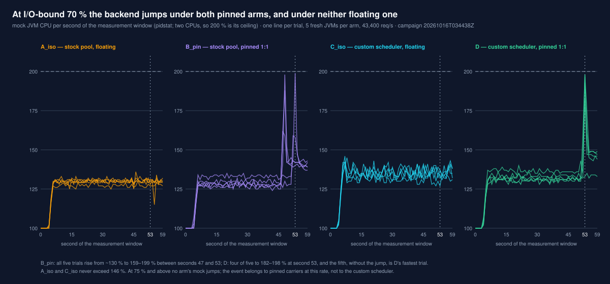

# Capacity at a fixed p99: pinning the stock scheduler's workers buys what the custom scheduler bought

*Five virtual-thread scheduler arms on two capacity ladders, with the p99 objective, the pass rule
and the reading of each arm fixed before the campaigns ran.*

> **What this is.** The second result of the research track `research/loom-carrier-scheduler`
> (kernel `docs/research/loom-carrier-scheduler/research.md`, HYP-CAPACITY). The first,
> [*Pinned carriers hold the open-loop tail near capacity, and only there*](2026-10-14-loom-carrier-scheduler-pinned-carriers-and-the-open-loop-tail.md),
> compared tails at fixed rates and left two questions this one answers: how much rate each arm
> carries at a fixed tail, and whether the pinned custom scheduler's advantage comes from its
> per-carrier queues or from the pinning. It uses the same kernel build, JDK build, host,
> request path and gates, adds two arms, and replaces nothing in the first report except where §5
> says so.
>
> **Axis labels.** Tier **Community** (FFM POSIX socket transport, platform `Selector` reactors).
> Protocol **H1 cleartext**, as the load vehicle only. Family **Runtime**. Comparison axis:
> **scheduler arm, within one kernel commit**. Not a cross-runtime comparison and not a statement
> about the Enterprise `io_uring` transport.
>
> **`claim_scope: comparison_eligible`** is carried by exactly two campaigns, both under
> `results/raw/loom-carrier-scheduler/`: `20261016T002844Z-jdk-kbc26f9a0e8fc` (CPU-bound, 177 of
> 177 trials valid) and `20261016T034438Z-jdk-kbc26f9a0e8fc` (I/O-bound, 177 of 177 valid), both
> on harness commit `8b915264`, every trial on a shielded host. §6 compares the CPU-bound campaign
> with the first report's and is labelled exploratory where it names candidates.
>
> **`reproducibility_status: partial`.** Each regime rests on one campaign of 5 JVMs per cell. The
> capacity verdicts, every table and both figures are produced from the trial records by committed
> scripts (§8); no second person has re-derived them.

---

## TL;DR

1. **With a 1 ms backend both pinned arms hold p99 ≤ 5 ms to 95 % of the stock scheduler's
   saturation; both floating arms only to 50 %.** Capacity: `D` (custom scheduler, pinned) and
   `B_pin` (stock `ForkJoinPool`, pinned) **70,800 req/s**; `A_iso` and `C_iso` **37,300 req/s**.
   Without connection tracking on loopback the floating arms hold it to at least 70 % (the first
   campaign's ladder had no rung between 70 and 85 %; §6); the pinned arms hold it to 90–95 % in
   both states. HYP-CAPACITY is **not falsified** in this regime, and by the rule fixed for `B_pin` the gain is
   the pinning's: the stock scheduler pinned matches the custom one pinned at every rung to 95 %
   (medians within 0.41 ms of each other).
2. **With a 30 ms backend HYP-CAPACITY is falsified on its primary column.** Capacity at
   p99 ≤ 80 ms: `C_iso` 49,700 (80 %), `A_iso` 43,400 (70 %), `D` and `B_pin` **31,000 (50 %)**.
   Both pinned arms fail the 70 % rung and pass every rung from 75 % up to 85 % (`D`) or 95 %
   (`B_pin`); the supplementary column — highest passing rate — puts `B_pin` at 59,000, `D` at
   52,800, `C_iso` at 49,700 and `A_iso` at 43,400. `C_iso`'s lead in the primary column rests on
   a rung it passes by 0.26 ms.
3. **The 70 % stall recurred, and it follows the pinning, not the custom scheduler.** At
   43,400 req/s the mock backend's CPU jumps from ~130 % to 159–199 % between seconds 47 and 53 of
   the window in 5 of 5 `B_pin` and 4 of 5 `D` trials, and stays 7–18 points higher; under `A_iso`
   and `C_iso` it never exceeds 146 %, and at 75 % and above no arm's does. `D`'s one trial without
   the jump is again its fastest. The first report could say only that the event occurred under
   `D`; the stock scheduler pinned triggers it too (§5).
4. **Under pinning, the custom scheduler adds nothing with a 1 ms backend and costs with a 30 ms
   one.** `D` against `B_pin`: medians within 0.41 ms of each other at every CPU-bound rung to 95 %;
   with the 30 ms backend `D`'s p99 is above `B_pin`'s in every trial at 50, 75, 85 and 90 % (45.6
   against 40.7 ms at 85 %, 149 against 42 ms at 90 %), `D` sustains no trial at 95 % where
   `B_pin` passes, and its closed-loop saturation is 55,382 req/s against 62,829.
5. **The reproduction of the stock pool through the SPI holds in one regime and misses by 1.5 ms
   in the other.** Unpinned (`B_float`) against the built-in (`A_iso`) at 85 %: accepted with the
   1 ms backend (p = 0.69); with the 30 ms backend p = 0.42, but `B_float`'s median (199.42 ms)
   lies 1.54 ms below `A_iso`'s fastest trial (200.96 ms), so the range clause fails and, as
   registered, `B_pin` is read against `B_float` there: **40.7 against 199.4 ms**, every `B_pin`
   trial below every `B_float` trial.
6. **The floating arms' CPU-bound tails moved between campaigns because of the host's packet
   filtering; the pinned arms' did not.** At 70 % `A_iso`'s p99 is 9.81 ms (4.23–13.63) here
   against 2.46 ms in the first campaign; carriers spend 8–10 more points of CPU in every arm.
   This campaign ran in a boot in which the Docker daemon had run, leaving connection tracking and
   NAT rules loaded, and the first one did not. Profiled, the extra time is netfilter's (0.2 → 6.8 % of the carriers'
   samples, both schedulers). In one boot, exempting loopback from tracking takes `A_iso` from
   8.59 to 2.70 ms (every trial apart) and leaves `D` at 2.56 against 2.52 ms (§6). The regime's
   verdict holds in both states: on the first campaign's data `A_iso`'s capacity is 70 % and `D`'s
   at least 90 %, the top of that ladder.
7. **Five JVMs per cell is enough for a decision rule, not for a pairwise test.** The smallest
   exact two-sided p at 5 against 5 is 0.0079; this report's 140 tests set a Bonferroni threshold
   of 0.0004, which no pair can reach. Capacities are the registered rule applied to cell medians;
   pairwise statements below say *complete separation* (every trial of one arm below every trial
   of the other) or give the ranges.
8. **Not tested:** cache locality (HYP-CACHE), the `kernel` backend, more than two carriers, a
   dedicated machine, and the cause of the 70 % stall.

### At a glance

Capacity is the primary result (the highest rate below which every rung passed); the highest
passing rate is supplementary. Rates as a fraction of `A_iso`'s saturation in the same campaign.

| regime, objective | `A_iso` | `B_pin` | `C_iso` | `D` |
|:--|--:|--:|--:|--:|
| CPU-bound, p99 ≤ 5 ms — capacity | 50 % | **95 %** | 50 % | **95 %** |
| — highest passing rate | 50 % | 95 % | 50 % | 95 % |
| I/O-bound, p99 ≤ 80 ms — capacity | 70 % | 50 % | **80 %** | 50 % |
| — highest passing rate | 70 % | **95 %** | 80 % | 85 % |

CPU-bound capacities are from a campaign run with connection tracking on loopback; without it
`A_iso`'s is at least 70 % (§6).

The scheduling-algorithm × pinning table at 85 %, median p99 in ms (`B_float` beside `A_iso`):

| regime | stock, floating (`A_iso` / `B_float`) | stock, pinned (`B_pin`) | custom, floating (`C_iso`) | custom, pinned (`D`) |
|:--|--:|--:|--:|--:|
| CPU-bound, 63,400 req/s | 26.27 / 38.94 | **2.75** | 98.43 | **2.63** |
| I/O-bound, 52,800 req/s | 222.98 / 199.42 | **40.67** | 305.41 *4/5* | **45.63** |


---

## 1. Setup

The request path, host, CPU layout, JDK, kernel build and trial gates are the first report's
(§1.1–§1.4 there). What differs:

### 1.1 Arms

| arm | scheduler | carrier placement |
|:--|:--|:--|
| `A_iso` | stock `ForkJoinPool` (`parallelism = maxPoolSize = 2`) | both workers allowed on CPUs 2, 3 |
| `B_pin` | stock `ForkJoinPool`, reproduced through the SPI | worker 1 on CPU 2, worker 2 on CPU 3 |
| `B_float` | as `B_pin`, binding off | both workers allowed on CPUs 2, 3 |
| `C_iso` | `ExerisCarrierScheduler`: one MPSC queue per carrier, no work stealing | both carriers allowed on CPUs 2, 3 |
| `D` | `ExerisCarrierScheduler` | carrier 0 on CPU 2, carrier 1 on CPU 3 |

`B_pin` is `PinnedForkJoinScheduler` in the benchmark app, loaded with
`-Djdk.virtualThreadScheduler.implClass`. The plan was a `ForkJoinPool` whose
`ForkJoinWorkerThread`s bind themselves when they start; reading the JDK showed that this would be
a different pool from the built-in one, because the JDK keeps paths for carrier threads and for
its built-in scheduler alone. `B_pin` therefore reproduces the built-in scheduler rather than
approximating it:

- the pool is built with the built-in's arguments — async mode, parallelism, `maxPoolSize` and
  `minRunnable` from the same `jdk.virtualThreadScheduler.*` properties with the same defaults,
  saturation always allowed, 30 s keep-alive — so stealing, spinning and worker retirement are the
  stock pool's;
- its workers are `jdk.internal.misc.CarrierThread`s, so the JDK's carrier-only paths (lazy submit
  after a park, external submit on yield, compensation around blocking calls) apply to them;
- the two submit paths the JDK reserves for its built-in scheduler by identity (a thread started
  from a virtual thread goes to the submission queue; a thread unparked from a virtual thread is
  pushed without a wakeup) are taken under the same conditions;
- each worker binds itself to a free CPU of the carrier set when it starts and releases it when it
  terminates, so a worker the pool retires and later replaces is bound like the first.

Building it showed that a scheduler implemented through the SPI reaches these paths only through
internal access: `CarrierThread` is in `jdk.internal.misc`, the current carrier is read through
`jdk.internal.access`, and the two submit paths are selected by the scheduler's identity, so a
custom scheduler has to re-create them itself. `B_pin` needs `--add-exports` for both packages at
compile and run time; a custom scheduler written against the public SPI alone runs without the
carrier-only paths.

`B_float` is the same class with `-Dloom.bench.pinned.bind=false`: what remains is the
reproduction, and `B_float` against `A_iso` checks it. The isolation gate holds `B_pin` to `D`'s
rule — at the end of the window, two workers, one CPU each, no other server thread on a carrier CPU
— and rejects a worker that reported it could not bind. In all 96 `B_pin` and `B_float` trials of the two
campaigns, saturation included, each JVM started exactly two workers, every `B_pin` worker bound, and none
was retired.

### 1.2 Ladders and objectives

| | CPU-bound | I/O-bound |
|:--|--:|--:|
| campaign | `20261016T002844Z-jdk-kbc26f9a0e8fc` | `20261016T034438Z-jdk-kbc26f9a0e8fc` |
| backend think time / connections / backend pool | 1 ms / 100 / 128 | 30 ms / 5,000 / 2,048 |
| warmup (open loop) / measurement | 30 s / 30 s | 30 s / 60 s |
| ladder base: `A_iso` median saturation, n = 3 | 74,531 req/s | 62,063 req/s |
| rungs (50 %, then 70–100 % in steps of 5 %) | 37,300 … 74,500 | 31,000 … 62,100 |
| p99 objective | 5 ms | 80 ms |
| trials: saturation + ladder (4 arms × 8 rungs × 5) + `B_float` at 85 % | 12 + 160 + 5 | 12 + 160 + 5 |
| wall time | 3 h 16 min | 4 h 45 min |

One fresh server JVM and one fresh mock JVM per trial; within each repetition the ladder cells and
the `B_float` cells run in an order shuffled from a recorded seed.

**The rule** (registered before the run, applied by `slo_ladder.py`): a rung passes for an arm when
at least 4 of its 5 trials are valid, every valid trial sustained the rate, and the median p99 of
the valid trials is at most the objective. An arm's **capacity** is the highest rung up to which
every rung passes; the highest passing rung is reported beside it. The objectives were set with the
first campaigns' results known, and placed where no known median decides a rung. I set the
I/O-bound one at 80 ms rather than 65 ms because 65 ms lay on `A_iso`'s known 70 % median; the move
does not favour `D` (its known 70 % median, 96.3 ms, failed both). research.md gives the reasoning in full.

### 1.3 What else changed since the first CPU-bound campaign

The first report's CPU-bound campaign ran on harness `84685a1c`; between it and `8b915264` the
benchmark app's backend pool changed from a `LinkedBlockingDeque` to a fair `Semaphore` over a
`ConcurrentLinkedDeque` (`e33e9595`), and the harness began raising the trial's descriptor limit
to 1,048,576 (`c6979e96`). The first I/O-bound campaign already ran with both. §6 tests both, finds
neither matters, and finds what does.

---

## 2. CPU-bound regime: 1 ms backend, objective 5 ms

Median p99 in ms over the valid trials, range in brackets; *k/5* marks a rung where only k trials
sustained the rate. Bold: the rung passes.

| rung | `A_iso` | `B_pin` | `C_iso` | `D` |
|:--|--:|--:|--:|--:|
| 50 % · 37,300 | **2.65** [2.63–2.69] | **2.62** [2.60–2.65] | **2.68** [2.65–2.69] | **2.68** [2.66–2.72] |
| 70 % · 52,200 | 9.81 [4.23–13.63] | **2.52** [2.52–2.57] | 14.16 [8.34–24.62] | **2.53** [2.52–2.94] |
| 75 % · 55,900 | 9.06 [6.39–17.22] | **2.62** [2.60–2.65] | 26.46 [15.97–44.67] | **2.56** [2.54–2.82] |
| 80 % · 59,600 | 17.90 [11.18–50.08] | **2.67** [2.65–2.72] | 41.31 [18.74–61.34] | **2.64** [2.63–2.90] |
| 85 % · 63,400 | 26.27 [18.78–56.45] | **2.75** [2.69–2.76] | 98.43 [51.17–112.13] | **2.63** [2.59–2.71] |
| 90 % · 67,100 | 42.53 [28.06–52.19] | **3.12** [2.74–15.65] | 162.69 [54.33–243.07] | **2.71** [2.64–3.17] |
| 95 % · 70,800 | 66.88 [51.52–109.76] | **2.92** [2.89–3.54] | 796.67 *1/5* | **2.78** [2.72–3.09] |
| 100 % · 74,500 | 201.85 [48.86–247.04] | 38.21 [3.23–128.57] | 1,740 *0/5* | 59.39 [5.51–231.55] |

- **The pinned arms hold the objective to 95 % and are indistinguishable from each other.** From
  70 % to 95 % every `B_pin` and `D` trial is below every `A_iso` and `C_iso` trial; the closest
  is one `B_pin` trial at 90 % (15.65 ms) against `A_iso`'s fastest there (28.06 ms). `D` against
  `B_pin`: complete separation only at 50 %, where `D` is higher by 0.06 ms; at 85 % `D` is lower
  by 0.12 ms with one overlapping pair (p = 0.016); no difference that matters anywhere.
- **The floating arms leave the objective at the first rung above 50 %**, and `A_iso`'s tail at
  70–75 % is spread across JVMs (4.23–17.22 ms). From 70 % to 95 % their carriers wait 1.5–5.5 % (`A_iso`) and
  5.1–15.5 % (`C_iso`) of the window for a CPU; pinned carriers at most 0.03 %, as in the first
  campaign.
- **At 100 % no arm passes.** The pinned arms' medians jump to 38 and 59 ms with single trials
  still at 3.2 and 5.5 ms; `C_iso` sustains no trial at 95 % or above.

## 3. I/O-bound regime: 30 ms backend, objective 80 ms

| rung | `A_iso` | `B_pin` | `C_iso` | `D` |
|:--|--:|--:|--:|--:|
| 50 % · 31,000 | **42.75** [34.69–47.81] | **37.34** [33.73–40.93] | **42.46** [39.78–48.67] | **48.74** [41.98–62.30] |
| 70 % · 43,400 | **70.78** [66.50–96.83] | 118.91 [68.93–137.21] | **55.42** [53.12–57.60] | 82.88 [39.42–164.35] |
| 75 % · 46,500 | 152.32 [136.19–174.98] | **35.94** [35.13–38.65] | **64.03** [63.13–67.52] | **39.52** [38.85–41.79] |
| 80 % · 49,700 | 171.90 [143.36–189.57] | **39.62** [39.17–40.03] | **79.74** [70.85–132.61] | **40.61** [39.17–41.50] |
| 85 % · 52,800 | 222.98 [200.96–1,010] | **40.67** [37.34–44.74] | 305.41 *4/5* | **45.63** [44.96–83.46] |
| 90 % · 55,900 | 212.99 [174.46–333.31] | **42.01** [41.31–46.78] | 2,920 *0/5* | 149.38 [130.37–530.43] |
| 95 % · 59,000 | 330.49 [280.32–590.85] | **49.02** [45.57–55.90] | 5,970 *0/5* | 2,930 *0/5* |
| 100 % · 62,100 | 808.45 *3/5* | 109.12 [73.15–411.14] | 8,370 *0/5* | 5,540 *0/5* |

(Medians in this table are over the valid trials, as the rule counts them, so a rung that did not
sustain every trial shows the median of all five; `summary.md` gives the medians of sustained
trials only.)

- **The 70 % rung decides the primary column.** Both pinned arms fail it, by median and by spread
  (`D` 39.42–164.35 ms, `B_pin` 68.93–137.21 ms); both floating arms pass. Under the "all lower
  rungs pass" rule that stops `D` and `B_pin` at 50 %. §5 shows the event behind it. Two of the
  cells that decide this column sit near the objective: `C_iso` at 80 % passes with a median of
  79.74 ms (0.26 ms under it), and `D` at 70 % fails with 82.88 ms from a bimodal spread
  (39.42–164.35 ms). With five trials a cell either could fall the other way in a repetition;
  `B_pin`'s failure at 70 % (118.91 ms) and `A_iso`'s pass (70.78 ms) do not.
- **From 75 % up, the pinned stock scheduler is the best arm at every rung.** Every `B_pin` trial
  is below every `A_iso` trial from 75 % to 95 %. `B_pin` is the only arm that sustains its rate in
  every trial to 100 %.
- **The custom scheduler pinned trails the stock one pinned.** `D`'s p99 is above `B_pin`'s in
  every trial at 50, 75, 85 and 90 %; the margins are 3–11 ms to 85 % and over 100 ms at 90 %, and
  at 95 % `D` sustains no trial. Closed-loop saturation agrees: `D` 55,382 req/s, `B_pin` 62,829,
  `A_iso` 62,063 (the first campaign measured `D` at 55,704). Two `D` trials at 85 % (82.24 and
  83.46 ms) sit above the objective, inside a passing rung. `D`'s carriers are plain
  `Thread`s where `B_pin`'s are `CarrierThread`s, but in these runs that difference is not in
  play: with `maxPoolSize = parallelism = 2` the stock pool cannot compensate for a blocked worker,
  and no `B_pin` JVM started a third; and `D`'s carrier queues a task woken from itself without
  waking anything, as the stock pool's lazy submit does. What separates them is the scheduling:
  per-carrier queues without stealing, a started thread kept on the starting carrier, and an idle
  carrier that parks at once where the pool's idle workers rescan for work first.
- **The custom scheduler unpinned passes the most rungs in a row, then stops sustaining its
  rate.** `C_iso` holds 80 ms to 80 %, misses the rate in one trial at 85 % and in every trial
  above; its closed-loop saturation is 52,048 req/s, 84 % of the base.

---

## 4. Against the hypothesis

HYP-CAPACITY, as registered: *held to a p99 objective — 5 ms with the 1 ms backend, 80 ms with the
30 ms backend — the pinned custom scheduler (`D`) carries a higher rate than the isolated stock
scheduler (`A_iso`). Falsified, per regime, if `D`'s capacity is not above `A_iso`'s.*

| regime | `D` capacity | `A_iso` capacity | verdict |
|:--|--:|--:|:--|
| CPU-bound, 5 ms | 70,800 (95 %) | 37,300 (50 %) | **not falsified** |
| I/O-bound, 80 ms | 31,000 (50 %) | 43,400 (70 %) | **falsified** |

The supplementary column orders the I/O-bound regime the other way (`D` 85 % against `A_iso`'s
70 %), and it is supplementary because it was registered so. The registered column asks for a
service that, run at its capacity, also runs at every rate below it; with the 30 ms backend a
pinned arm does not.

**Attribution through `B_pin`**, by the rule registered beside it — *where `B_pin`'s capacity
lands attributes `D`'s: at `D`'s, pinning carries it; at `A_iso`'s, the per-carrier queues do; in
between, both*:

- **CPU-bound: at `D`'s (95 %). Pinning carries it.** The custom scheduler adds no capacity and no
  tail; the stock pool with its workers pinned does the same.
- **I/O-bound: the rule does not apply.** `D`'s capacity is below `A_iso`'s, so there is no
  advantage to attribute, and the reproduction check did not accept `B_pin`'s comparison with
  `A_iso` in this regime. `B_pin` lands at `D`'s capacity because both fail the same rung, for the
  reason in §5. Above that rung `B_pin`'s highest passing rung is above `D`'s: under pinning, the
  custom scheduler costs capacity (§3).

**The reproduction check.** Registered: accept when `B_float`'s p99 does not separate from
`A_iso`'s (exact two-sided Mann–Whitney p ≥ 0.05) and `B_float`'s median lies inside the range of
`A_iso`'s trials; otherwise read `B_pin` against `B_float`.

| regime, 85 % | `B_float` p99, sorted | `A_iso` p99, sorted | p | median inside range | verdict |
|:--|:--|:--|--:|:--|:--|
| CPU-bound | 23.01, 29.44, 38.94, 44.86, 102.33 | 18.78, 23.71, 26.27, 46.37, 56.45 | 0.69 | yes | **accepted** |
| I/O-bound | 158.21, 197.12, 199.42, 248.19, 790.53 | 200.96, 210.05, 222.98, 239.36, 1,010 | 0.42 | no, 1.54 ms below | **not accepted** |

With the 30 ms backend the reproduction misses on the range clause alone, on the faster side of
`A_iso`, by 1.54 ms. As registered, `B_pin` is read against `B_float` in that regime: at 85 %
`B_pin`'s p99 is 37.34–44.74 ms and `B_float`'s 158.21–790.53 ms, complete separation, and the
binding is the only difference between the two. `B_float` ran at 85 % only, so it has no capacity
of its own, and the I/O-bound comparisons of `B_pin` with `A_iso` in §3 carry the reproduction's
uncertainty; with 5 trials a side the check was designed to catch a broken reproduction, not a
subtle one, and it does not show a broken one.

**What the two campaigns support** is narrower than either column alone: **with a 1 ms backend,
pinning two carriers raises the rate that holds a 5 ms p99 from the 50 % rung to the 95 % rung in
this campaign (from 70 % to at least 90 % on the first campaign's data), whichever scheduler owns
the carriers; with a 30 ms backend pinning carries more rate from 75 % up and fails the objective at 70 %
on this rig, and the custom scheduler is a cost there, not the source of the gain.**

---

## 5. The I/O-bound 70 % stall, again — under both pinned arms

The first report (§5.3 there) found `D`'s tail at 43,300 req/s bimodal across JVMs and located the
stall on the mock backend's side: its CPU jumped to its two-CPU ceiling near second 53 of the
window in 9 of 10 `D` trials and never under the floating arms. It could not say whether the event
belonged to the custom scheduler or to the pinning, because no arm pinned the stock scheduler.

This campaign's 70 % rung is 43,400 req/s. Mock CPU per second, every trial at that rung:



| arm | trials with the jump | mock CPU before → peak, % | second of the peak | p99 of those trials, ms | p99 without it, ms |
|:--|:--|:--|:--|:--|:--|
| `B_pin` | 5 of 5 | 126–134 → 159–199 | 47–48 (three), 52–53 (two) | 68.93–137.21 | — |
| `D` | 4 of 5 | 130–137 → 182–198 | 53 | 66.62–164.35 | 39.42 |
| `A_iso` | 0 of 5 | 125–136, no peak | — | — | 66.50–96.83 |
| `C_iso` | 0 of 5 | 129–146, no peak | — | — | 53.12–57.60 |

After the jump the mock stays 7–18 points above its earlier level for the rest of the window in
every trial that had one. At 75 and 80 % no arm's mock jumps: no trial's peak is more than 19 points above its own
baseline, where the jumps at 70 % were 31–72 points and the mock had 33–63 points of headroom
below its ceiling, and both pinned arms pass those rungs. From 85 % the mock runs within 14–53
points of its ceiling, where the same criterion is less sensitive; no peak there exceeds 19 points
either.

What this adds to the first report:

- **The event is not the custom scheduler's.** The stock pool, pinned, triggers it at least as
  often as `D` does. The per-carrier FIFO without stealing, which the first report could not
  exclude, is excluded; what the two triggering arms share is that each carrier owns one CPU.
- **It recurs in a second campaign at the same rate**, so it is a property of this rig at about
  43,000 req/s with pinned carriers, not of one campaign.
- **It is still not explained.** The exclusions of the first report stand (server-side
  virtual-thread pinning, the read sub-poller, GC in either JVM, connection churn, the mock's idle
  timeout). The candidates that remain are the same two — a mock-side event (JIT or
  deoptimisation, compensation in its `ForkJoinPool`) and the request pattern a server with pinned
  carriers sends. The absence of the jump at 75–80 % weighs against a trigger counted in requests
  served, such as a compilation threshold in the mock: the ~3.5 million requests a fresh mock has
  served by second 50 at 43,400 req/s are reached near second 36 at 52,800 req/s, with no jump.
  What remains is a trigger that depends on the rate or on the traffic's shape. The three tests
  that would separate the candidates are unchanged: a 60 s warmup, a JIT,
  deoptimisation and pinning record of the mock, and the arrival pattern at the mock. `B_pin`
  against `A_iso` is now the cleaner pair for all three: the same scheduling algorithm, and only
  the binding differs.
- **It occurs without connection tracking, as far as that run can show.** Both I/O-bound campaigns, the first report's and this
  one, ran with connection tracking left loaded by the Docker daemon (§6.3). The first report's
  diagnostic run `20261015T041646Z` did not. It ran from 06:16 to 07:37 from a text console, and the
  graphical session and the Docker daemon first started in that boot at 07:38. In 7 of its 15 unprofiled `D` trials at 70 % the mock's
  CPU rose from ~120 % to 158–199 % between seconds 45 and 55. Its trials carry a latency probe,
  and whether `nf_conntrack` was loaded was not recorded then; on this host it is not loaded at
  boot (§6.1).

---

## 6. The CPU-bound floating arms moved between campaigns, with the host's packet filtering

*Two campaigns, run a week apart, compared at neighbouring rates; two drift-check runs that test
the recorded differences between them; a kernel profile of each host state; and a check that
toggles the cause in one boot.*

| | first campaign `20261009T040618Z` | this campaign `20261016T002844Z` |
|:--|:--|:--|
| harness | `84685a1c` | `8b915264` |
| ladder base (`A_iso` saturation) | 75,998 req/s | 74,531 req/s |
| `A_iso` p99 at ~70 % | 2.46 ms at 53,200 (nine of ten ≤ 2.52, one 11.35) | 9.81 ms at 52,200 (4.23–13.63) |
| `C_iso` p99 at ~70 % | 2.54 ms (2.50–2.68) | 14.16 ms (8.34–24.62) |
| `D` p99 at ~70 % | 2.47 ms (2.43–2.55) | 2.53 ms (2.52–2.94) |
| `A_iso` p99 at ~85 % | 11.89 ms at 64,600 | 26.27 ms at 63,400 |
| `D` p99 at ~85 % | 2.58 ms | 2.63 ms |
| `A_iso` carrier run-queue wait at ~70 % | 0.03–0.13 % | 1.5–3.2 % |
| carrier CPU at 50 %, `A_iso` / `D` | 86.1 / 84.5 % at 38,000 | 95.8 / 92.5 % at 37,300 |
| CPUs utilised at 50 %, `A_iso` / `D` | 1.22 / 1.21 | 1.32 / 1.31 |

The server JVMs ran with identical flags apart from ports, on the same JDK and Linux builds, with
the governor, boost and shield recorded the same. Two recorded differences remain (§1.3): the app's
backend pool (a fair `Semaphore` since `e33e9595`) and the descriptor limit (raised since
`c6979e96`).

**The check.** `run-drift-check.sh` runs `A_iso` at 52,200 req/s with each backend pool (the app
at `84685a1c`, and the current one) under each limit (1,024 soft / 524,288 hard, systemd's default
for the unit the first campaign ran in, and 1,048,576), and `D` in the current configuration as a
control, 5 fresh JVMs per cell, the cells shuffled per repetition. Run
`20261021T040009Z-h25571385d799`, all 25 trials valid and sustained:

| cell | p99 median [range], ms | carrier CPU % | carrier sys % | carrier wait max % | CPUs |
|:--|:--|--:|--:|--:|--:|
| `A_iso`, pool old, limits old | 2.46 [2.45–2.52] | 119.56 | 79.23 | 0.13 | 1.675 |
| `A_iso`, pool old, limits new | 2.46 [2.44–2.48] | 120.00 | 79.08 | 0.10 | 1.672 |
| `A_iso`, pool new, limits old | 2.47 [2.45–2.51] | 119.93 | 79.14 | 0.10 | 1.707 |
| `A_iso`, pool new, limits new | 2.46 [2.45–2.76] | 119.90 | 79.36 | 0.10 | 1.676 |
| `D`, pool new, limits new | 2.47 [2.46–2.47] | 115.73 | 80.04 | 0.03 | 1.675 |

Neither factor moves `A_iso`: pool old against new, 10 trials each, p = 0.53; limits old against
new, p = 0.68; no level of either factor differs within a level of the other (p ≥ 0.55). And every
cell, the current configuration included, reproduces the first campaign, not this one: p99 2.46
against 2.46 ms then and 9.81 ms here, carrier sys 79 % against 80.1 % then and 88.7 % here. The
first report's §9.2 judgement holds: neither change touches the CPU-bound regime.

**What does go with the difference is the host's packet filtering.** Every run here is behind the
same shield, from a text console. In none of these four runs was the Docker daemon running: it runs in
the graphical session and stops when that session ends. The four split two against two by whether
it had run earlier in the same boot, which each boot's kernel log shows as container interfaces
created before the run started:

| run | started after boot | Docker daemon ran earlier in the boot | `A_iso` p99 at ~70 %, ms | carrier sys %, `A_iso` |
|:--|--:|:--|:--|--:|
| first campaign `20261009T040618Z` | 4 min | no | 2.46 | 80.1 |
| drift check `20261021T040009Z` | 2 min | no | 2.46 | 79.4 |
| this campaign `20261016T002844Z` | ~14 h | yes | 9.81 | 88.7 |
| first drift check `20261016T195614Z` (pool new, limits new only) | ~34 h | yes | 7.23 | 89.7 |

A daemon that has run containers has loaded connection tracking and its NAT rules into the host's
iptables. They stay when it stops, until the next boot. From then on every loopback packet between
the load generator, the server and the backend passes the conntrack and NAT hooks, though none of
it goes near a container.

It does not build up over a campaign. Within this campaign `A_iso`'s carrier sys at 52,200 req/s
is 88.3–89.3 % from its first trial (position 35 of 177) to its last (166), and its p99 falls
rather than rises with position (13.63 ms first, 4.23 and 5.88 ms in the last two). Within the
first campaign the same arm stays at 77.1–80.7 % over 2.5 h, and its one slow trial at 70 %
(11.35 ms) ran early, at position 35 of 129. The state is switched on, not accumulated.

### 6.1 Where the carriers' extra time goes

`run-kernel-profile.sh` ran twice in one boot at 52,200 req/s: three clean `A_iso` trials, and
three each of `A_iso` and `D` sampled with `perf record -g` on the carrier CPUs. The first run
started 9 minutes after boot, before the Docker daemon had run in that boot. The second started
15.2 h after boot. The daemon had run during the day and had stopped with the graphical session,
and connection tracking was still loaded (582 tracked connections at the window's start).

| | `20261022T044235Z`, 0.2 h | `20261022T194321Z`, 15.2 h |
|:--|--:|--:|
| `nf_conntrack` loaded | no | yes |
| clean `A_iso` p99, ms | 2.45, 2.46, 2.47 | 10.06, 48.80, 84.54 |
| carrier CPU / sys, `A_iso`, % | 119.9 / 79.8 | 127.8 / 89.3 |
| netfilter symbols, % of `A_iso`'s carrier-CPU samples | 0.16 | 6.78 |
| netfilter symbols, % of `D`'s carrier-CPU samples | 0.18 | 6.90 |

The symbols that grow are netfilter's and nothing else's: `ipt_do_table` (0 → 1.41 %),
`nf_hook_slow`, `nf_conntrack_in` and `nf_conntrack_tcp_packet`, `tcp_in_window`,
`resolve_normal_ct`, and the `nf_nat_*` hooks on the local paths. Every other kernel symbol holds
or falls slightly. About 6.8 % of the carriers' samples at 128 % carrier CPU is about 8.7 points,
which is the 8 points the carriers' CPU rose by. Netfilter costs both schedulers the same. The
profiled trials carry a recorder, so their latencies are not results. `D`'s three under the
recorder, 6.56, 44.96 and 94.33 ms, are left for §6.2's unrecorded control.

### 6.2 Exempting loopback from tracking removes the floating arm's tail

`run-netfilter-check.sh` takes one boot and one state, with the Docker daemon running and its
rules loaded (`iptables-at-start.txt` in the run). It runs each
arm with and without two raw-table rules that exempt loopback traffic from connection tracking
(`-i lo` and `-o lo -j CT --notrack`), set or removed before each trial, 5 fresh JVMs per cell in a
shuffled order. Run `20261023T044314Z-h3e3496678846`, 25–46 min after boot, all 20 trials valid and
sustained:

| cell | p99 median [range], ms | carrier CPU % | carrier sys % | carrier wait max % | CPUs |
|:--|:--|--:|--:|--:|--:|
| `A_iso`, tracked | 8.59 [5.54–12.49] | 130.07 | 89.10 | 2.77 | 1.795 |
| `A_iso`, notrack | 2.70 [2.52–3.31] | 126.90 | 85.60 | 1.07 | 1.767 |
| `D`, tracked | 2.56 [2.52–2.62] | 126.10 | 89.70 | 0.03 | 1.772 |
| `D`, notrack | 2.52 [2.50–2.72] | 123.02 | 86.94 | 0.03 | 1.764 |

- **`A_iso`:** every tracked trial is above every notrack one (exact p = 0.0079, the smallest 5
  against 5 can give). The tracked cell reproduces this campaign's 70 % rung (9.81 ms,
  4.23–13.63), and the notrack cell comes within 0.24 ms of the runs without the daemon's rules.
- **`D`:** the same rules take the same 3 points of sys from its carriers and leave its tail where
  it was (p = 0.22).

This is the first report's mechanism with a cause attached. The extra kernel time raises every
arm's carrier load. Floating carriers then wait for a CPU more often (2.77 % against 1.07 % here)
and their tail grows. Pinned carriers do not wait.

The step from tracked to notrack removes 3.5 of the roughly 9 points of carrier sys the rules add
(89.1 against 85.6 %, against 79.8 % without them). Yet `A_iso`'s p99 falls from 8.59 to 2.70 ms,
close to a host without the rules. At this rate the floating arm sits on a threshold where a few
points of per-request kernel time move its tail by a factor of three, and the pinned arm does not
move at all. A floating arm's capacity is therefore a fragile number on any host whose
per-packet cost can change.

The rules exempt loopback from tracking and NAT, not from iptables. `ipt_do_table` still runs for
the raw and filter tables. The notrack cells' sys stays 6 points above that of the runs without the daemon's rules (85.6
against 79.8 %), and their tail 0.24 ms above. That remainder was not profiled. Every trial of
this run reports `harness_clean` failed. Its one uncommitted change is the executable bit of
`summarize_netfilter.py`, set in the index and not on disk; that script runs only after the
trials, and the content of every harness file is that of `3e349667`.

One deviation stays unexplained. In the ~34 h run the control `D` was also off its usual tail (p99
median 5.34 ms, two trials at 82.56 and 248.32 ms) with no carrier wait. The unrecorded control
here shows no such movement under the same rules.

### 6.3 What it changes

The campaigns' comparison already showed the pattern. Carrier CPU per request rose by about 10 % in
**every** arm, and only the floating arms' tails moved; §6.2 reproduces both halves under control.
The I/O-bound regime's two campaigns both ran with containers started before them (~3 h and ~17 h
after boot). They agree within their spread: `A_iso` at 70 % had 65.81 then 70.78 ms, `D` at 85 %
had 52.61 then 45.63 ms, and CPUs at 50 % for `A_iso` were 1.32 then 1.34. Whether connection
tracking moves that regime was not tested.

It does not change the CPU-bound verdict. Applied to the first campaign's data, the same rule gives
`A_iso` and `C_iso` a capacity of 70 % and `D` at least 90 %, the top of that ladder. It does change
how `A_iso`'s capacity is quoted: 50 % of saturation with connection tracking on loopback, at least
70 % without it, where the first campaign's ladder has no rung between 70 and 85 %. The pinned arms hold 5 ms to 90–95 % in both states. Runs meant to be compared with
each other, here or on another host, need the same packet-filtering state. Since `3e349667` every
trial records the netfilter modules loaded and whether loopback was exempted (`host.txt`), and
since `0868577a` a trial that ran with `nf_conntrack` loaded fails the `host_untracked` evidence
gate. The gate applies from `0868577a` on; the campaigns in this report and the first report's
I/O-bound one were eligible under the gates in force when they ran, and their connection-tracking
state is stated in §6 and in the first report's §1.2.

---

## 7. What was measured, and what was not

- **The cause of the 70 % stall** (§5): narrowed to pinned carriers, not explained; it occurs
  without connection tracking too.
- **What remains of the CPU-bound drift** (§6.2): with loopback exempted from tracking,
  `A_iso`'s carriers keep 6 points of sys and 0.24 ms of p99 above a host without the Docker
  daemon's rules; the iptables tables still traversed are the candidate, not profiled. Whether
  connection tracking moves the I/O-bound regime, and the `D` deviation in the ~34 h run, are not
  tested.
- **Capacity between rungs.** A capacity of 95 % means the 95 % rung passed and 100 % did not;
  the true limit lies in between, and for the I/O-bound primary column between 50 % and 70 %.
- **A second campaign per regime.** Each ladder ran once, 5 JVMs per cell.
- **Cache locality (HYP-CACHE), the `kernel` backend, more than two carriers, other hosts.** As in
  the first report (§8 there). The shield is still the best case for pinning: nothing else lands
  on a carrier CPU.
- **Anything about H2, H3, TLS, the Enterprise `io_uring` transport, or the stock JDK.** `B_pin`
  needs a `VirtualThreadScheduler` implementation, which exists only on the Loom `fibers` EA
  build.

**Closed-loop saturation, recorded but not a claim.** Each campaign measured every arm's
closed-loop saturation to set its ladder: `wrk` at 100 and 5,000 connections, three fresh JVMs per
arm. Three trials against three cannot give an exact two-sided p below 0.1, and research.md keeps
saturation out of the claims, so the table is a record, not a comparison.

| regime | arm | req/s, median [range] | CPUs utilised, server JVM | req/s per CPU |
|:--|:--|--:|--:|--:|
| CPU-bound | `A_iso` | 74,531 [73,835–74,640] | 2.40 | 31,029 |
| | `B_pin` | 76,131 [74,197–76,649] | 2.44 | 31,239 |
| | `C_iso` | 69,070 [68,531–70,333] | 2.26 | 30,499 |
| | `D` | 76,949 [76,326–77,151] | 2.56 | 30,105 |
| I/O-bound | `A_iso` | 62,064 [61,988–62,377] | 2.45 | 25,322 |
| | `B_pin` | 62,829 [60,948–63,196] | 2.48 | 25,431 |
| | `C_iso` | 52,048 [51,802–52,464] | 2.42 | 21,441 |
| | `D` | 55,382 [55,076–55,555] | 2.63 | 20,957 |

Both campaigns ran with connection tracking loaded on loopback (§6), which adds carrier CPU per
request in every arm.

With the 1 ms backend `D`'s median is the highest, 818 req/s above `B_pin`'s with overlapping
ranges, and its rate per CPU is the lowest of the four: the margin comes with more CPU, not with
less work per request. With the 30 ms backend both custom-scheduler arms carry 11–17 % less than
the stock ones. Maximum throughput is to be measured in its own campaign, with a registered
hypothesis, against the scheduler's next revision, with the current `D` as its control.

---

## 8. Reproducing

Everything below assumes the `exeris-benchmarks` commit this report was published at, on the
branch `research/loom-carrier-scheduler`, with an `exeris-kernel` checkout beside it. Prerequisites
are the first report's (§9.2 there).

### 8.1 Re-derive every figure from the recorded trials

```bash
R=results/raw/loom-carrier-scheduler
CPU=$R/20261016T002844Z-jdk-kbc26f9a0e8fc   IO=$R/20261016T034438Z-jdk-kbc26f9a0e8fc

# trial.json and summary.md from the raw outputs (rewrites in place; `git diff` shows any change)
scripts/loom-carrier-scheduler/reparse_campaign.py $CPU
scripts/loom-carrier-scheduler/reparse_campaign.py $IO

# §2-§4: capacity, highest passing rung and the reproduction check (slo.md, slo.json)
(cd scripts/loom-carrier-scheduler && ./slo_ladder.py ../../$CPU && ./slo_ladder.py ../../$IO)

# §2-§4: medians, ranges, exact Mann-Whitney for every pair, and the Bonferroni count
(cd scripts/loom-carrier-scheduler && ./stats.py ../../$CPU ../../$IO)

# both figures
tools/render-report-charts-20261016.py
```

The per-second mock CPU in §5 is each trial's `pidstat-mock.txt`. The §6 comparison uses the first
report's CPU-bound campaign, `20261009T040618Z-jdk-kbc26f9a0e8fc`, and the drift checks under
`results/raw/loom-carrier-scheduler-drift/`:

```bash
(cd scripts/loom-carrier-scheduler && \
  ./summarize_drift.py ../../results/raw/loom-carrier-scheduler-drift/20261021T040009Z-h25571385d799)

# §6.1: the two kernel profiles and their comparison
K=results/raw/loom-carrier-scheduler-kprof
scripts/loom-carrier-scheduler/kernel_profile.py compare \
  $K/20261022T044235Z-h84b7f398c0dd $K/20261022T194321Z-h84b7f398c0dd

# §6.2: the loopback tracking check
(cd scripts/loom-carrier-scheduler && \
  ./summarize_netfilter.py ../../results/raw/loom-carrier-scheduler-netfilter/20261023T044314Z-h3e3496678846)
```

`20261016T195614Z-hc1ee5b476f91` is the first drift check, in which the limits-old cells did not
start (the harness then set the hard limit before the soft one); its other 15 trials are valid.
For the runs before `27663996`, the time from boot in §6 comes from the host's boot list
(`journalctl --list-boots`) against each run's start. Whether the Docker daemon had run earlier in a
run's boot comes from that boot's kernel log: a `veth` interface entering promiscuous mode before the
run's start time. The profile runs record their uptime and tracked-connection count (`n/a` when
`nf_conntrack` is not loaded), and the netfilter run records its netfilter modules. Neither profile run's `perf-record.data` is committed; each
profiled trial's `perf-record-report.txt` is.

### 8.2 Re-run the campaigns

From a text console with the graphical session stopped:

```bash
sudo systemctl isolate multi-user.target
tmux new -s bench
cd <workspace>/exeris-benchmarks
sudo CAMPAIGNS="cpu-slo io-slo" scripts/loom-carrier-scheduler/run-sequence.sh
sudo systemctl isolate graphical.target
```

`run-sequence.sh` applies the shield, builds the kernel at `bc26f9a0e8fc` from `git archive`, and
runs both ladders with the parameters in §1.2 — saturation first, the ladder from that campaign's
own `A_iso` median, `B_float` at 85 % beside it — then `slo_ladder.py`, and restores the host on
any exit. The two took 8 h here. A campaign is citable when its `summary.md` reports every trial
valid, the harness committed and the host shielded.

---

## Revision history

| date | change |
|---|---|
| 2026-10-23 | §7 records the closed-loop saturation of every arm, with CPUs utilised, as a record rather than a claim; §5's heading on connection tracking states what the run can show; §6.3 states that the `host_untracked` gate applies from `0868577a` on. No figure changed. |
| 2026-10-23 | Review pass: §5 records the stall in a run without connection tracking; §6.2 states how little kernel time moves the floating arm's tail; §6.3 names the `host_untracked` evidence gate; TL;DR 1, At a glance and §6.3 quote the capacity without tracking as at least 70 %; §7 follows. |
| 2026-10-23 | §6 identifies the CPU-bound drift: kernel profiles at 0.2 h and 15.2 h after one boot (`results/raw/loom-carrier-scheduler-kprof/`, harness `84b7f398`) and the loopback connection-tracking check `20261023T044314Z-h3e3496678846` (harness `3e349667`); the run table gains whether the Docker daemon had run earlier in the boot; TL;DR 1 and 6, At a glance, §1.3, §7 and §8.1 follow. |
| 2026-10-21 | First publication. Campaigns `20261016T002844Z-jdk-kbc26f9a0e8fc` (CPU-bound, 177 trials) and `20261016T034438Z-jdk-kbc26f9a0e8fc` (I/O-bound, 177 trials), harness `8b915264`, both evidence-eligible under the scenario's gates; drift checks `20261016T195614Z-hc1ee5b476f91` and `20261021T040009Z-h25571385d799` (§6); objectives, pass rule, `B_pin` reading and reproduction check as registered in kernel research.md at `b05d4a13`. |

**Updated:** 2026-10-23
*By Arkadiusz Przychocki*
